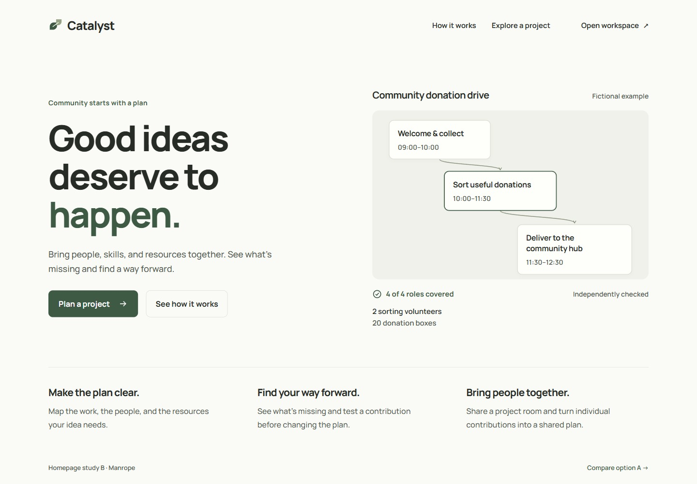

# Homepage typography options — approval checkpoint

These are **two isolated local homepage studies**, prepared after rejecting the serif/minimal direction. Neither has been selected or applied to Catalyst's workspace, editor, collaboration screens, or production site. No existing application file was changed for this study. Do not roll out either option until the owner chooses it.

| | A | B |
| --- | --- | --- |
| Typeface throughout the page | Plus Jakarta Sans | Manrope |
| Desktop headline | 74px, weight 780, line-height 1.075 | Identical |
| Supporting copy | 18px, weight 500, line-height 1.7 | Identical |
| Buttons / navigation | 700 / 650 | Identical |
| Composition and content | Warm near-white, charcoal, forest green, three-line headline and real task model | Identical |

Each page self-hosts just its named family. Instrument Serif, Newsreader, Geist, and other named font families are absent from these pages. No gradient, glow, stock image, generated illustration, decorative pattern, or invented percentage is used. The browser's rendered-font inspection confirms PlusJakartaSans-ExtraBold for A and Manrope-ExtraBold for B (the latter font's internal family name is “Manrope ExtraLight”; the actual rendered weight is 780).

## Actual desktop screenshots

Both were captured in the built-in browser at a 1440 × 1000 CSS-pixel desktop viewport. The full-page images include the comparison footer; text metrics cause a small difference in full-page height.

### A — Plus Jakarta Sans


### B — Manrope



## Critical comparison

The original references were inspected alongside the actual captures. Their useful common elements are the warm light surface, confident dark UI text, green primary action, balanced left-copy/right-project composition, readable project nodes, and limited navigation. Those relationships guide these options. The references' serif hero is deliberately replaced according to the newest instruction; neither option claims to be a pixel-for-pixel copy.

**A:** the wider, rounder headline occupies the left column more firmly. Its body text and button shapes feel friendlier and more substantial. It is my preference for the requested warm, confident direction.

**B:** the headline is slightly narrower and the letterforms feel more restrained. It remains bold and comfortable, while producing a tighter overall typographic texture. It is a useful direct alternative rather than a different layout disguised as a font comparison.

The project model is intentionally quieter than the headline. It has only three actual tasks and two real prerequisite connections. The canvas has a solid neutral fill; selected-task framing is the only emphasized node border. A first rendered pass caught a task extending past the canvas; the final version fits all nodes, with connections calculated from their real positions. Main copy is dark and substantial; limited metadata is 14px rather than tiny gray labels.

## Functional and scope checks

- The existing fictional donation-drive scenario is passed through the unchanged solver and independent verifier during generation. Its actual result is **4/4 role slots covered**. This is a generated example snapshot, not a claim about a real event or a live room.
- Clicking a task changes its real role and supply requirements. Verified delivery selection in A, and keyboard Enter on intake in B. The final screenshots show the sorting task in both.
- The primary CTA opens the existing Catalyst workspace. The secondary action scrolls to the explanation. The compare links switch between the local studies.
- Actual browser inspection found no page overflow at 320, 390, and 1440 pixels for either option. No physical-device claim is made.
- Lint, TypeScript, and all **143 existing tests in 15 files** passed. No test, engine, verifier, Gemini integration, API, database, permission, scenario, or product-screen implementation was edited. No live provider request was made.
- [Browser typography and interaction evidence](browser-verification.json).

## Local preview and reproduction

From the Catalyst repository root:

```powershell
node --import tsx design-studies/homepage-options/generate.ts
node design-studies/homepage-options/serve.mjs
```

Open [A](http://127.0.0.1:3101/a.html) or [B](http://127.0.0.1:3101/b.html). The existing application should remain running on port 3100 for the workspace links. The study server binds to loopback and serves only an explicit file allowlist; it does not serve repository sources, private files, or credentials.

Fonts came from the official Google Fonts directories for [Plus Jakarta Sans](https://github.com/google/fonts/tree/main/ofl/plusjakartasans) and [Manrope](https://github.com/google/fonts/tree/main/ofl/manrope). Copyright and SIL Open Font License 1.1 wording is preserved in the accompanying `fonts/*-OFL.txt` files; only trailing whitespace was normalized. The logo is the existing Catalyst SVG mark. No reference image is copied into or redistributed with the studies.

**Selection recorded:** the owner chose Option A and authorized its application across the product. These files preserve the earlier A/B review; see [the integrated rollout](../../docs/JAKARTA_DESIGN_REVIEW.md). Publishing and recording remain paused pending the owner’s review of the completed application.
