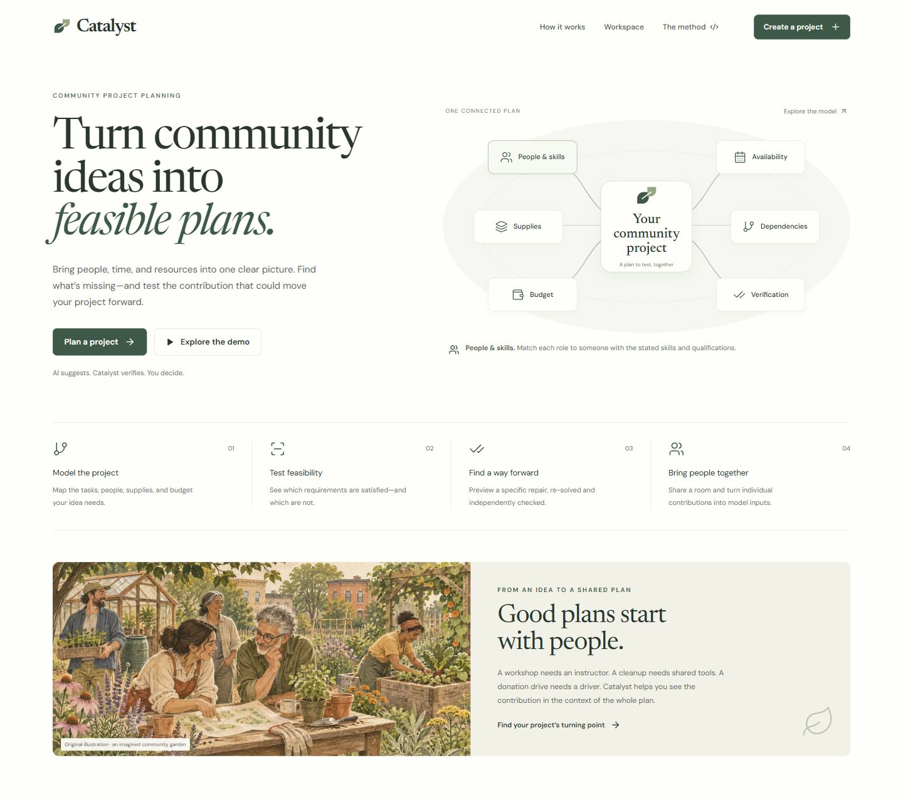
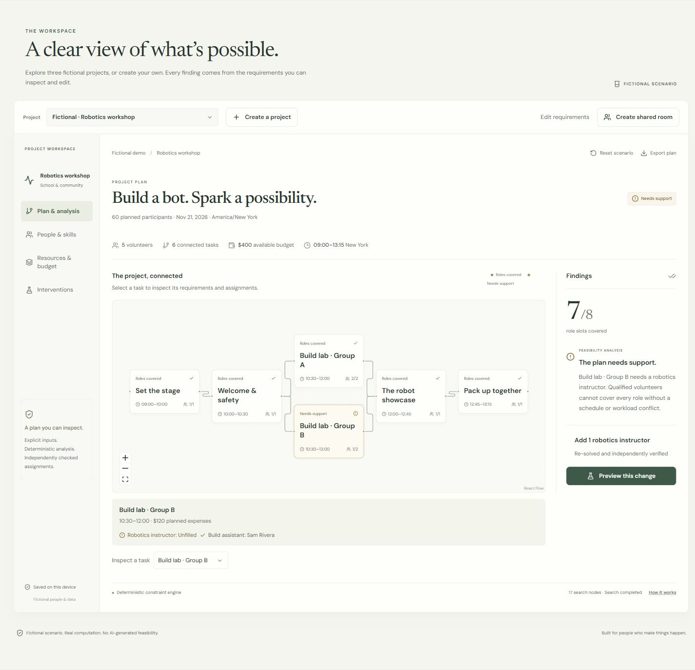
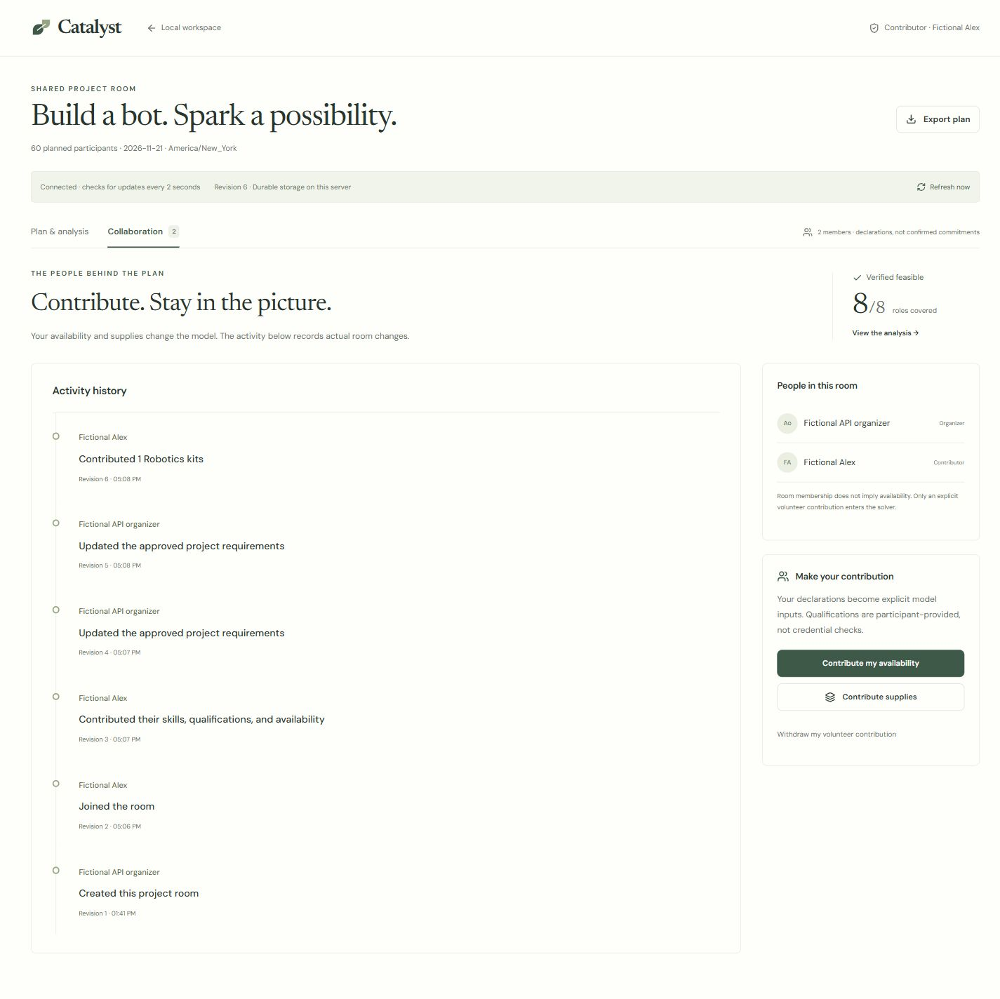

# Catalyst visual redesign — review before publication

November 21, 2026. Local branch: `codex/visual-redesign`. **Nothing from this redesign has been pushed or publicly deployed.** The public Vercel site remains on `9cdf756`. No video was generated/recorded and no Devpost submission was made.

The local **production build** is served at http://127.0.0.1:3100. Use the open Codex browser tabs for the saved organizer and contributor room examples; room authorization belongs to those browser sessions. This loopback preview is not a public deployment.

## What changed and why

The deployed product was audited before editing: all three scenarios, repair previews, creation/editing, a real Gemini proposal and approval screen, room creation, existing managed collaboration, and desktop/mobile layouts. Before images came from that actual deployed version.

The audit found repeated marketing messages inside the product, decorative floating labels with little explanatory value, a graph competing with large summary panels, and inconsistent typography and secondary controls. The redesign keeps the mathematical outputs and existing controls while changing their hierarchy:

- **Homepage:** an editorial headline and two clear actions, an explorable six-part model diagram, four specific benefits, and an original community illustration. No invented adoption, impact, partner or probability claims.
- **Workspace:** a larger central planning canvas, compact findings alongside it, quieter project navigation, explicit roles-covered counts, readable task inspection and a direct repair-preview path. Native graph buttons also support keyboard activation.
- **Collaboration:** separate Plan & analysis and Collaboration views over the existing room data. The latter exposes actual activity, members, contribution controls and live model results. It adds no chat, files, live calls, account system or fabricated social activity.
- **Creation:** the same five steps, calmer forms, serif dialog titles, secondary styling for optional Gemini drafting, clearly unapproved proposals, editable assumptions/questions and unchanged explicit approval.
- **Identity:** one leaf/connection mark across the homepage, rooms, invitation/loading states and favicon; self-hosted Newsreader and DM Sans; cream surfaces, forest green, sage, fine borders and restrained shadows.
- **Interaction:** small color/border transitions, native details and keyboard controls; reduced-motion settings suppress transitions and smooth scrolling.

## Before-and-after gallery

All screenshots are actual browser renders. After images use the local production build; they are not mockups. Room events and members are actual fictional QA records, not frontend filler. The old and redesigned room screenshots may show different test rooms and revisions.

| Surface | Before: deployed UI | After: local redesign |
| --- | --- | --- |
| Desktop homepage | [Before](screenshots/redesign/before/home-desktop.jpg) | [After](screenshots/redesign/after/home-desktop.jpg) |
| Robotics workspace | [Before](screenshots/redesign/before/workspace-desktop.jpg) | [After](screenshots/redesign/after/workspace-desktop.jpg) |
| Organizer room | [Before](screenshots/redesign/before/collaboration.jpg) | [Plan](screenshots/redesign/after/room-plan-desktop.jpg), [collaboration](screenshots/redesign/after/collaboration-desktop.jpg) |
| Contributor room | Earlier production evidence in `screenshots/production/` | [Desktop](screenshots/redesign/after/contributor-collaboration-desktop.jpg), [mobile](screenshots/redesign/after/contributor-collaboration-mobile.jpg) |
| Mobile homepage | [Before](screenshots/redesign/before/mobile-home.jpg) | [After](screenshots/redesign/after/home-mobile.jpg), [first-screen preview](screenshots/redesign/after/home-mobile-preview.jpg) |
| Mobile workspace | Same earlier interface | [After](screenshots/redesign/after/workspace-mobile.jpg) |
| Mobile room | [Before](screenshots/redesign/before/mobile-room.jpg) | [Plan](screenshots/redesign/after/room-plan-mobile.jpg), [activity](screenshots/redesign/after/collaboration-mobile.jpg) |
| Project editor | [Before](screenshots/redesign/before/project-editor.jpg) | [Requirements](screenshots/redesign/after/requirements-desktop.jpg), [mobile](screenshots/redesign/after/editor-mobile.jpg) |
| Live Gemini review | [Before](screenshots/redesign/before/gemini-proposal.jpg) | [Desktop](screenshots/redesign/after/gemini-desktop.jpg), [mobile](screenshots/redesign/after/gemini-mobile.jpg) |
| Human approval | [Before](screenshots/redesign/before/approval.jpg) | [After](screenshots/redesign/after/approval-desktop.jpg) |

Additional proof: [repair preview](screenshots/redesign/after/intervention-desktop.jpg), [custom project](screenshots/redesign/after/custom-project-desktop.jpg), [mobile custom project](screenshots/redesign/after/custom-project-mobile.jpg), [stale draft rejection](screenshots/redesign/after/stale-draft-mobile.jpg), [contributor repair restrictions](screenshots/redesign/after/contributor-permissions.jpg).

### Redesigned homepage

### Redesigned planning workspace

### Redesigned collaboration

## Design system

| Area | Implementation |
| --- | --- |
| Color | Ink `#24372e`, forest `#315b46`, muted `#657168`, sage `#edf1e7`, paper `#f6f5ef`, surface `#fffefa`, border `#e2e4da`; ochre for unmet requirements |
| Type | Newsreader editorial headings; DM Sans controls/body; self-hosted variable files and included OFL licenses |
| Spacing | 4/8/12/16/24/32px scale, with generous section margins and tighter product spacing |
| Controls | Solid primary action, bordered secondary action, quiet utility actions; visible focus outlines and explicit disabled states |
| Status | Icons plus text and actual counts, including verified versus unmet states; no invented percentages |
| Responsive | Product navigation becomes a scrollable tab row; findings move above the canvas; forms become one column; graphs retain pan/zoom and a keyboard-accessible task selector |
| Motion | 150–160ms color/border transitions; reduced-motion overrides verified in the actual browser |

The presentation layer is isolated in `src/app/design.css`, with the existing functional component styles retained. Font and artwork sources, licensing and the exact image-generation prompt are in [asset credits](ASSET_CREDITS.md).

## Verification

- **143/143 tests**, 15 files; lint, TypeScript and optimized production build pass. No original tests were removed or changed.
- **19/19 actual local production room API checks** with independent HTTP sessions. These are backend checks, not independent browser-UI verification.
- Actual browser: robotics 7/8 → verified 8/8 repair/apply/reset; cleanup 4/5 → verified 5/5 repair/apply/reset; donation 4/4 → driver withdrawal 3/4 → verified repair preview, followed by reset.
- Native graph-node Enter activation updates task inspection. Modal Shift+Tab wraps to the last enabled control. Mobile navigation, the hero explanation controls and reduced-motion behavior are checked.
- Two real Gemini requests during this redesign: one deployed before-audit request and one local-production after request, both accepted on `gemini-3.5-flash-lite`. The latter stayed unapproved, retained assumptions/questions, created no roster/inventory, required explicit approval, exposed a 0/1 staffing gap, then reached independently verified 1/1 after a reviewed fictional volunteer. Mobile edit/reapproval and reload retained the result and updated metadata. The full ledger now records **17 provider-reaching attempts, 8 accepted, 9 historical unsuccessful**.
- Organizer room creation, availability and supply contributions, live revision updates, activity and preservation across production-process restart were observed. A stale draft was rejected visibly while retaining its contents and preserving the newer supply revision.
- Contributor bare-room denial, same-page invitation joining, fragment removal, availability/supply entry, reload persistence, organizer-control absence and disabled repair application passed. An independent **API organizer** changed/restored the budget; the contributor browser synchronized correctly, including an unmet budget despite 8/8 staffing.
- Actual browser layout checks at **320, 390, 768, 1024 and 1440px** show no document horizontal overflow. Key sampled text contrast is at least 4.85:1; this is a sampled check, not a claim of a complete accessibility certification.
- Exact configured credential scans pass for source, history and the built browser artifacts. Backend engine, verifier, ranking, provider, database, migrations, API routes, dependency versions and production security configuration are unchanged.

## Limits and publication gate

No new functional defect was found in the exercised flows. The redesigned UI has **not** been publicly deployed; its browser QA uses a local production server with persistent local rooms. The existing public Turso-backed app was inspected during the before audit; this redesign does not change its persistence implementation or credentials.

Two independently authenticated browser UIs in the same room remain unverified because the built-in browser does not support isolated contexts. Organizer and contributor UIs were exercised in separate fictional rooms; the contributor's organizer was an independent API client. Same-session tabs were used for the stale-draft UI check. None of these is mislabeled a two-browser UI pass.

Member revocation and account-based organizer recovery still do not exist. Existing sessions can last 30 days after invitation rotation. Repair search is still bounded, including the documented three-identical-new-volunteers limitation. No global minimum, real-world safety guarantee or verified human qualification is implied. A fatal React boundary was styled consistently but not deliberately triggered; provider outage/timeout/credential branches remain covered by the existing labeled tests rather than newly induced live failures.

**Next step: owner visual review.** After explicit approval, publish the reviewed branch to the existing repository, let Vercel deploy, and repeat the essential hosted browser/AI/room checks. Do not generate a video or submit to Devpost as part of this redesign approval.
