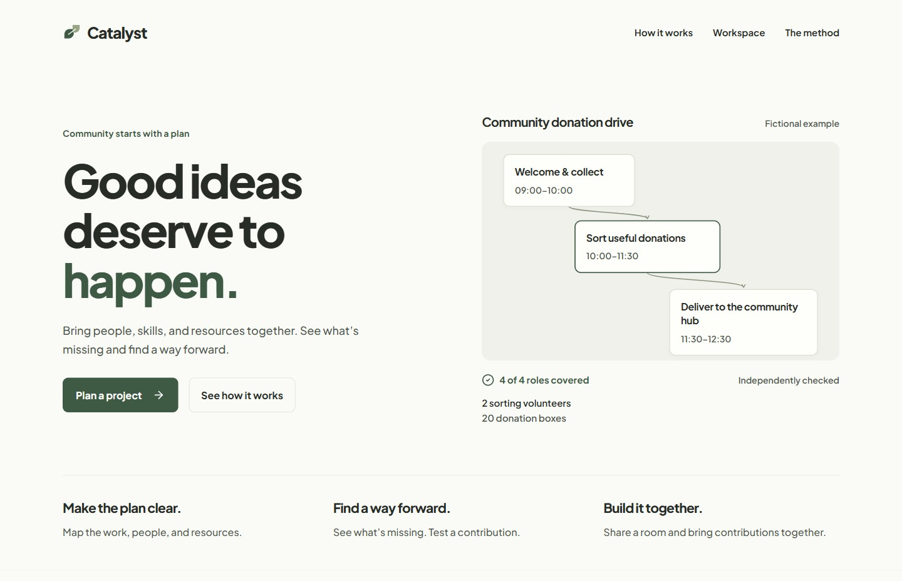
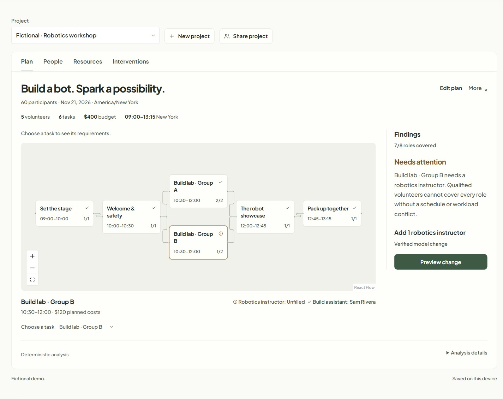
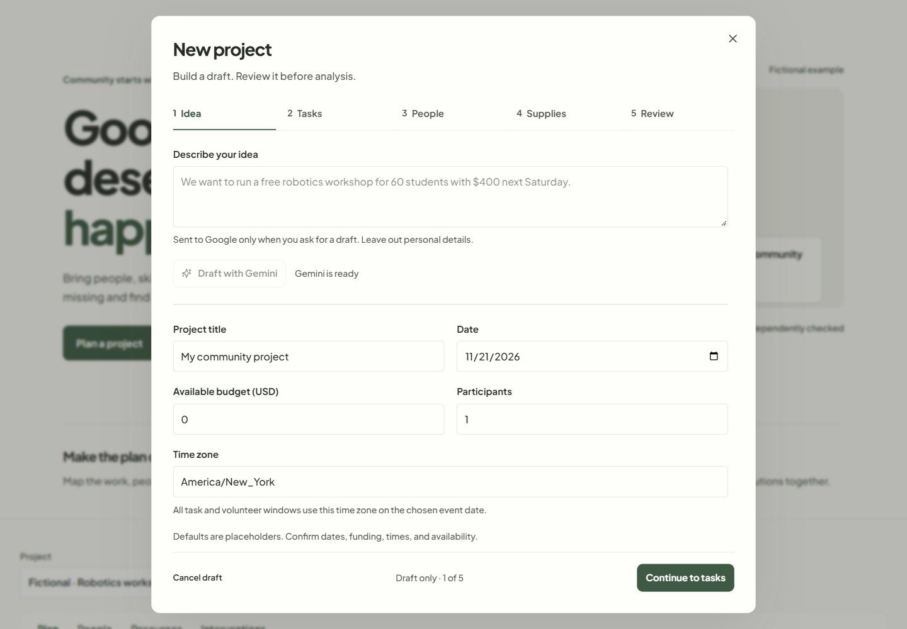
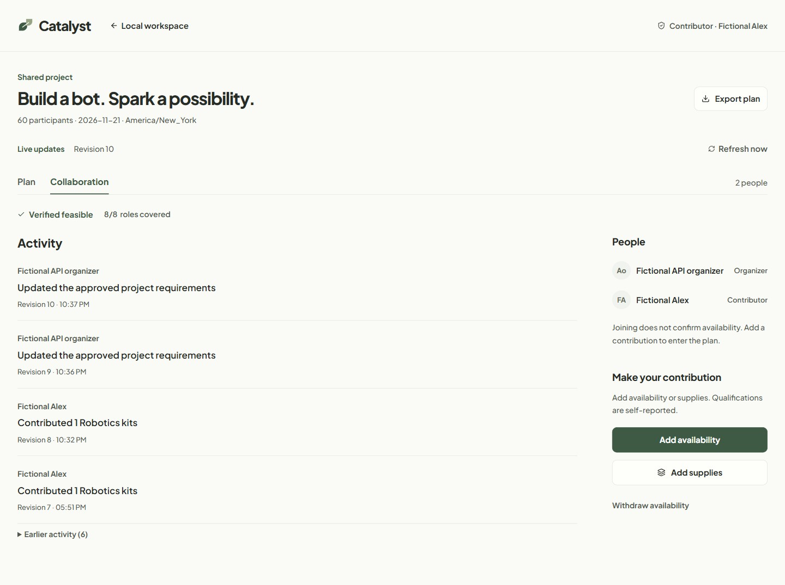

# Catalyst — approved Option A rollout

November 21, 2026 · Local review only · `codex/visual-redesign`

The selected Plus Jakarta Sans direction now carries through the homepage, planning workspace, project editor, sharing dialog, invitations, and collaboration interface. Nothing was pushed, publicly deployed, recorded, or submitted.

## What changed

- One self-hosted product family: **Plus Jakarta Sans**. The desktop homepage headline is 74px/780; project names, findings, controls, and form labels use comfortable, substantial weights. Inputs are 16px. The older serif/Geist/DM Sans files are removed.
- Warm near-white, charcoal text, restrained forest green, mildly rounded buttons, and fewer nested containers. Main navigation stays short.
- The homepage uses an original interactive diagram of the actual fictional donation-drive model. Three tasks, two real prerequisites, real selected-task requirements, and independently checked 4/4 coverage replace generic artwork. No new photograph or generated raster image was added; the unused garden illustration is removed.
- Shorter homepage, editor, workspace, and room copy. Secondary solver diagnostics and modeling explanations remain available in disclosures. Approval, AI disclosure, assumptions, real-world limits, role permissions, and invitation/session limitations remain visible or readily accessible.
- Workspace tabs are Plan, People, Resources, and Interventions. Reset/export remain under More. The actual project name and dependency graph lead the workspace.
- Collaboration shows four recent activity entries and preserves the remainder under Earlier activity. On mobile, contribution controls precede the activity feed. Organizer-only actions remain organizer-only.
- Dialog focus and return focus use `preventScroll` to avoid unnecessary page movement. Existing focus trapping, Escape dismissal, and explicit approval remain in place.

No solver/verifier logic, provider validation, API route, database schema/store, invitation authorization, or dependency was changed.

## Verification

| Gate | Result |
| --- | --- |
| Existing Vitest suite | **143/143**, 15 files |
| ESLint, zero warnings | Passed |
| TypeScript | Passed |
| Optimized Next.js/Webpack production build | Passed |
| Deterministic evaluation | **19/19** fixtures; all feasible certificates and returned repairs valid |
| Repairable evaluation fixtures | **12/12** with a verified repair |
| Brute-force oracle comparison | **200/200** matches |
| Local production room API checks | **19/19**, independent cookie sessions |
| Real browser layout checks | 320, 390, 768, 1024, 1440px homepage/workspace; editor and room checks at 320, 390, 768, 1440px |
| Rendered font inspection | Custom Plus Jakarta Sans in homepage, editor, and room headings |
| Release credential scan | See `evaluations/jakarta-verification.json` |

Actual browser interactions covered homepage task selection; robotics repair preview/apply/reset; cleanup's two-change repair; donation analysis; volunteer withdrawal/restore; budget controls; intervention navigation; mobile navigation; sharing dialog; editor cancellation/Escape; AI drafting, review, consent, approval, manual editing, reapproval and reload; contributor supply write/reload; complete activity disclosure; and organizer/contributor controls. No page-level horizontal overflow was observed at the inspected widths. The graph intentionally pans at narrow widths, with a native task picker as an alternative. These are emulated browser widths, not physical-device certification or a complete accessibility audit.

One real request to **`gemini-3.5-flash-lite`** returned an application-validated proposal; this phase had **1 accepted, 0 failed provider-reaching calls**. AI suggestions did not commit a roster or inventory and did not analyze automatically. Approval was disabled before consent. The approved reading-circle plan showed 0/1 staffing; manually entering a fictional host and reapproving produced independently verified 1/1, preserved after reload. Some generated questions repeated supplied facts and required human review. The date was confirmed with the native date control. Cumulative observed provider-reaching totals are now **18 attempts: 9 accepted, 7 historical provider errors, 2 historical validation rejections**. [Ledger](evaluations/ai-call-ledger.json).

The contributor's supply contribution persisted at revision 8. An independent organizer **API** change subsequently reached that browser through polling at revision 9 and changed the verdict to Requirements need review; restoring the budget at revision 10 restored Verified feasible. Expanding history exposed all nine records present at revision 9. Contributor UI exposed neither requirement editing nor invitation creation; organizer UI exposed both and retained the explicit approval gate.

**Independent browser limitation:** isolated browser contexts are unsupported by the available built-in browser. Separate organizer and contributor UIs were inspected in different QA rooms. Same-room permissions/concurrency were checked with independent HTTP sessions, and live polling used an owner API mutation plus a contributor browser. This does **not** establish a two-independent-browser UI pass. That pre-existing hosted acceptance gate remains open.

## Screenshots

These are actual screenshots of the local optimized production build, with fictional data. No screenshot contains credentials or an active invitation token. Editor images show the viewport; workspace and collaboration images show their complete content sections.

### Homepage

[Mobile homepage](screenshots/jakarta/after/homepage-mobile.jpg)

### Planning workspace

[Mobile planning workspace](screenshots/jakarta/after/workspace-mobile.jpg)

### Project editor

[Mobile project editor](screenshots/jakarta/after/editor-mobile.jpg)

### Collaboration

[Mobile collaboration](screenshots/jakarta/after/collaboration-mobile.jpg) · [Organizer's shared plan](screenshots/jakarta/after/shared-plan-desktop.jpg)

## Scope and remaining limits

The layout is ready for owner visual review at [the local preview](http://127.0.0.1:3100). Public production still serves the earlier release. Deploying this redesign and repeating hosted acceptance require the owner's next instruction; no deployment or recording is part of this change.

Member revocation and account-based organizer recovery remain unsupported and documented in the interface. Rotating an invite does not revoke existing sessions. Intervention search ranks a bounded candidate set and does not prove a global minimum. Gemini remains a source of untrusted suggestions requiring semantic review. No new backend defect was observed during this visual rollout.

[Browser observations](evaluations/jakarta-browser-verification.json) · [Quality-gate record](evaluations/jakarta-verification.json) · [Visual credits](ASSET_CREDITS.md) · [Production limits](PRODUCTION_VERIFICATION.md)
