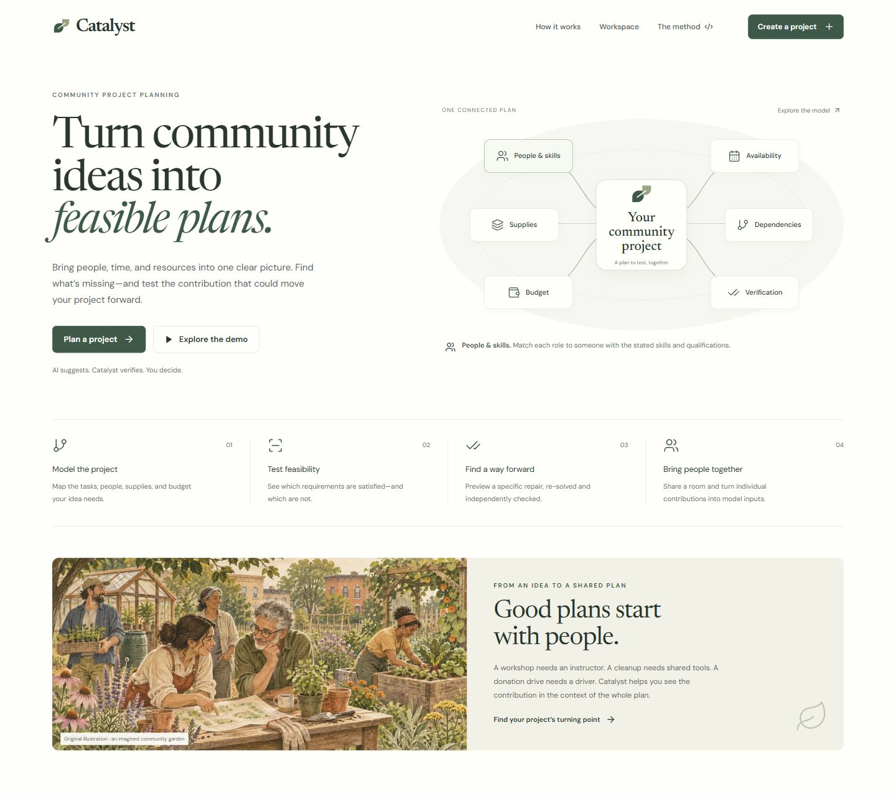
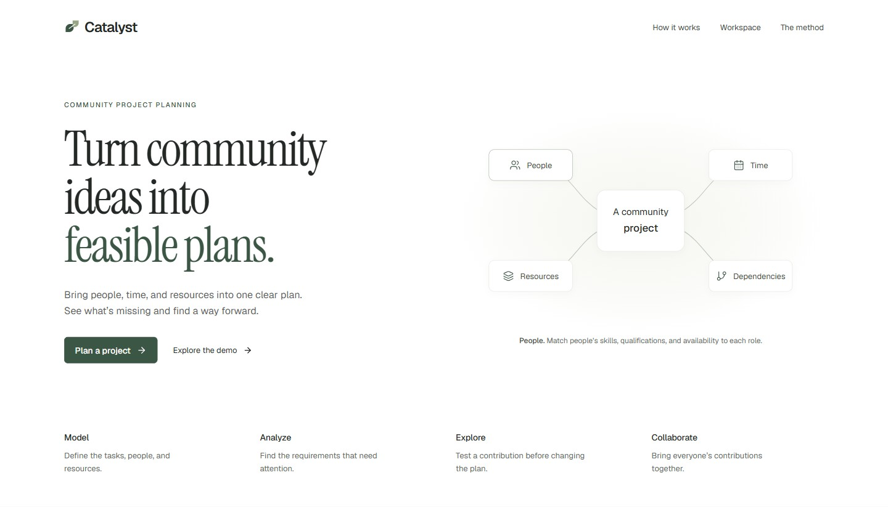
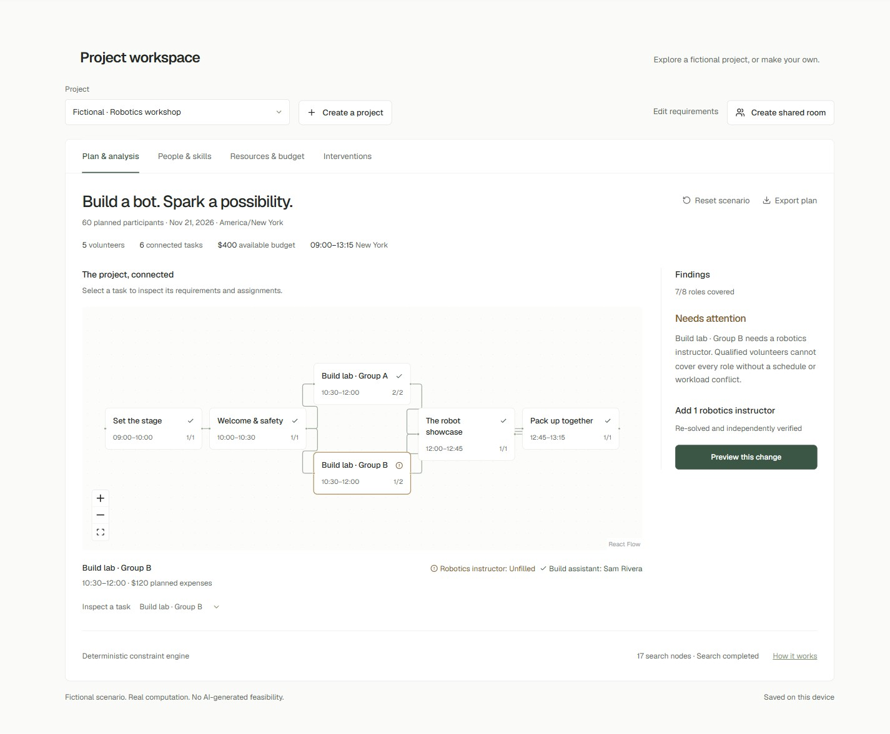
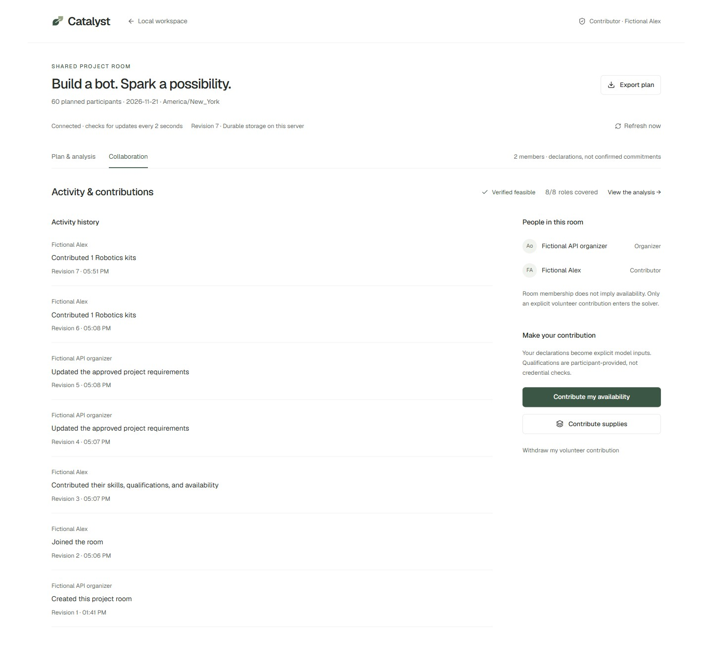
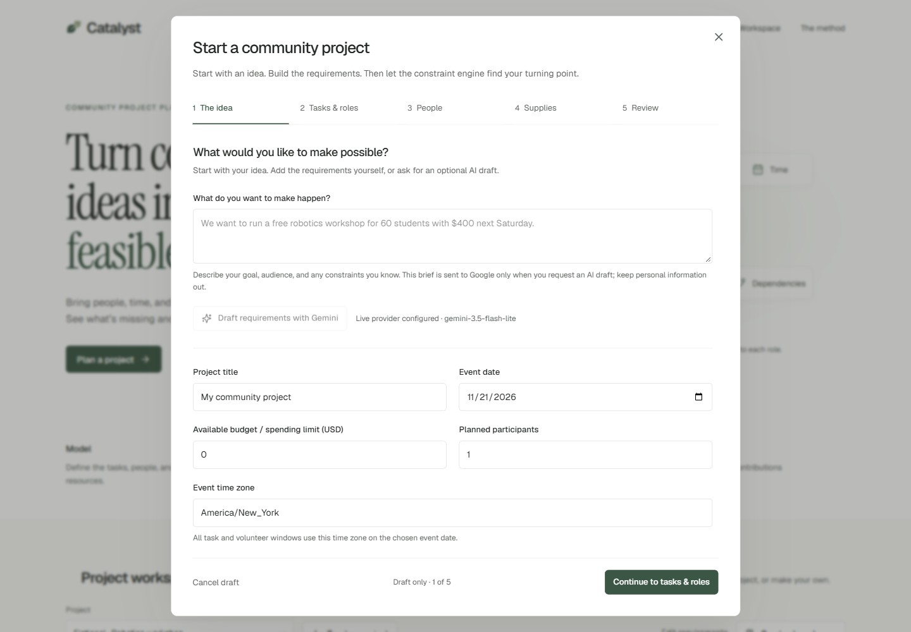

# Catalyst — minimal visual refinement

November 21, 2026. Local review on `codex/visual-redesign`, compared with the **previous redesign at `e01944b`**. This is a presentation refinement, pending owner approval before push or deployment. The live Vercel application is unchanged.

## What changed

| Area | Previous redesign (`e01944b`) | Current refinement |
| --- | --- | --- |
| Typography | Newsreader/DM Sans; serif project titles, dialogs, counts and supporting headings | Instrument Serif Regular only on the homepage headline; Geist throughout the interface |
| Headline | Large decorative italic final line | Three balanced roman lines, restrained tracking and forest-green final line |
| Homepage | Six explanatory nodes, model captions, icon/number benefits, artwork section, repeated CTAs | Four interactive model controls, short description, one primary CTA, quiet demo link, four plain text explanations; artwork and extra CTA sections removed |
| Navigation | Project switch, vertical icon menu, sidebar slogan and storage decorations | Four simple workspace tabs; storage status is retained in the footer |
| Findings | Project status pill, large serif count, result icon/eyebrow, repeated certificate box | One compact findings area with coverage, actual unmet requirement and a tested repair |
| Graph | Repeated coverage labels and time/people icons inside each node | Clear task title, status icon, time and actual coverage; neutral canvas and thin relationships |
| Collaboration | Large promotional heading, framed sidebar cards and decorated timeline | Actual activity rows, plain participant/contribution sections and compact result summary |
| Forms | More boxes, tinted summaries and numbered circular steps | Neutral form sections, unboxed expandable records, simple step navigation; on mobile the step names fit without number badges |

The replacement presentation stylesheet is roughly one ninth the line count of the preceding layer. Original functional styles remain underneath; no dependency, API, engine, scenario, database, invitation, or permission implementation was changed.

## Comparison with the supplied references

The reference images were visually inspected alongside actual desktop and mobile captures, including the previous redesign screenshots. The comparison focused on the UI inside the pictured devices, rather than copying the surrounding staged photography.

The current page follows the references' hierarchy: editorial headline on the left, one quiet project model on the right, white space around both, a restrained green primary action, and sans-serif product controls. Compared with the rejected redesign, the headline no longer shares its typeface with project titles or room headings, the artwork no longer competes with the model, and supporting content has less visual weight. The room uses the references' main-column activity and secondary participant layout, with actual names and records.

The implementation intentionally has fewer decorative cards than the references because the latest feedback explicitly asks for further simplification. Instrument Serif has a narrower, more contrasted shape than the earlier Newsreader. Forest green is reserved mainly for actions, selected navigation and meaningful states; the workspace surround is a light neutral. The model retains one very subtle ambient background; other content areas use plain surfaces.

No feasibility percentages, chat composer, file sharing, invented participants, fabricated updates, or other unimplemented reference features were copied. The homepage model explains inputs; its controls do not pretend to be a live project result. Product verdicts still come from the deterministic solver and verifier.

Rendered iteration caught and corrected a system-font fallback, a squeezed repair label/button, small repeated node status labels, mobile step wrapping, and a legacy 50% width restriction that stacked reset/export. Final captures were taken from the optimized local production build.

## Screenshot comparison

The left column below is **the preceding redesign**, not the older public release. Screens are actual browser captures. Room activity differs by one new fictional supply contribution; editor screenshots may show different draft contents.

| Surface | Previous redesign | Current refinement |
| --- | --- | --- |
| Homepage, desktop | [Before](screenshots/redesign/after/home-desktop.jpg) | [After](screenshots/minimal-refinement/after/home-desktop.jpg) |
| Homepage, mobile | [Before](screenshots/redesign/after/home-mobile.jpg) | [After](screenshots/minimal-refinement/after/home-mobile.jpg) |
| Planning workspace, desktop | [Before](screenshots/redesign/after/workspace-desktop.jpg) | [After](screenshots/minimal-refinement/after/workspace-desktop.jpg) |
| Contributor collaboration, desktop | [Before](screenshots/redesign/after/contributor-collaboration-desktop.jpg) | [After](screenshots/minimal-refinement/after/collaboration-desktop.jpg) |
| Contributor collaboration, mobile | [Before](screenshots/redesign/after/contributor-collaboration-mobile.jpg) | [After](screenshots/minimal-refinement/after/collaboration-mobile.jpg) |
| Project editor, mobile | [Before](screenshots/redesign/after/editor-mobile.jpg) | [After](screenshots/minimal-refinement/after/editor-mobile.jpg) |

Additional current captures: [desktop editor](screenshots/minimal-refinement/after/editor-desktop.jpg), [mobile workspace](screenshots/minimal-refinement/after/workspace-mobile.jpg), [organizer collaboration](screenshots/minimal-refinement/after/organizer-collaboration-desktop.jpg), [shared plan](screenshots/minimal-refinement/after/room-plan-desktop.jpg), [mobile people](screenshots/minimal-refinement/after/people-mobile.jpg), [mobile resources](screenshots/minimal-refinement/after/resources-mobile.jpg).

### Homepage: previous redesign

### Homepage: current refinement

### Planning workspace: current refinement

### Collaboration: current refinement

### Project creation: current refinement

## Verification

- Lint, standalone TypeScript check, all **143 tests in 15 files**, and optimized production build passed. No existing tests were removed or rewritten.
- The real local production HTTP room suite passed **19/19 checks**, using independent cookie sessions. This is separately labeled API evidence, not two-browser UI evidence. An initial sandboxed invocation could not reach the loopback service; the authorized local-network invocation passed.
- Real built-in browser: a new fictional reading-circle project was entered manually through tasks, people, supplies and review. Approval stayed disabled until the explicit review checkbox. Approval produced independently checked 1/1 coverage, and the project survived reload.
- Robotics: 7/8 → verified 8/8 preview and application → reset. Cleanup: 4/5 → verified 5/5 preview and application → reset. Donation drive: 4/4 → withdraw fictional Taylor Reed → 3/4 → verified 4/4 repair preview → reset.
- Graph task selection worked with Enter. Mobile menu opened and closed. Hero Resources changed the explanation. Editor reverse-Tab wrapped to the last enabled control, and Escape closed the draft.
- Actual contributor UI saved one fictional donated robotics kit, advanced revision 6 → 7, showed the real activity entry, and retained it across reload and production-server restarts. The organizer room retained revision 4. Contributor UI has no requirements-edit action; organizer UI retains it, and invitation/recovery limitations remain visible.
- Inspected home, workspace, room and editor at desktop/mobile sizes. No page overflow at 320, 390, 768, 1024 or 1440 CSS pixels. Narrow graphs retain panning/zoom and the full-text task selector; horizontal tab navigation can scroll on narrow phones. This was browser emulation, not a physical handset test.
- Sampled 14 text treatments: minimum contrast **5.4:1**. This is a sampled check, not a full accessibility certification. Reduced-motion emulation produced automatic scrolling and effectively zero transition duration, then was cleared. [DOM-derived layout/type/contrast evidence](evaluations/minimal-browser-layouts.json).
- Current presentation files and fonts were included in the release credential scan. See [latest scan](evaluations/security-release.json) and [verification record](evaluations/minimal-verification.json).

## Preserved boundaries and remaining limits

The solver/verifier, Gemini compiler and strict proposal validation, human approval, project editing, repair enumeration, shared-room data, roles, invitation security and API routes are unchanged. No new provider call was needed for this visual-only iteration. The Gemini UI reports the existing configured `gemini-3.5-flash-lite` model; that status is not presented as a new successful provider request. The observed live ledger remains **17 attempts: 8 accepted, 7 provider errors, 2 validation rejections**.

Two independently authenticated same-room browser contexts remain unverified because the available built-in browser shares a profile and does not expose isolation. The organizer and contributor interfaces inspected here use different fictional rooms. Independent API sessions do not replace that UI test. No account recovery or member revocation feature has been added. Bounded intervention-search limitations also remain as previously documented.

The new design is ready for owner visual review at [the local production preview](http://127.0.0.1:3100). Publication and deployment require approval. No hackathon video or Devpost submission was created.
